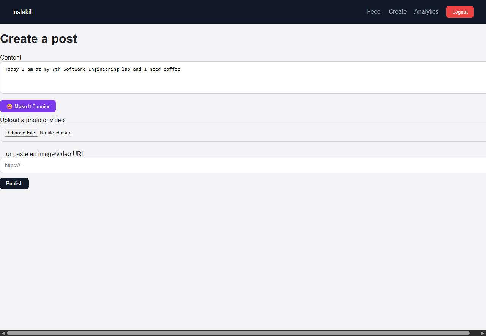
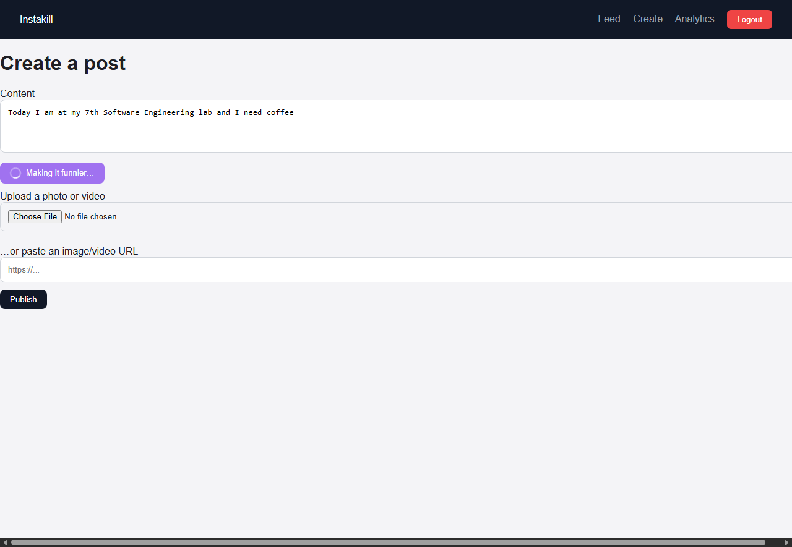
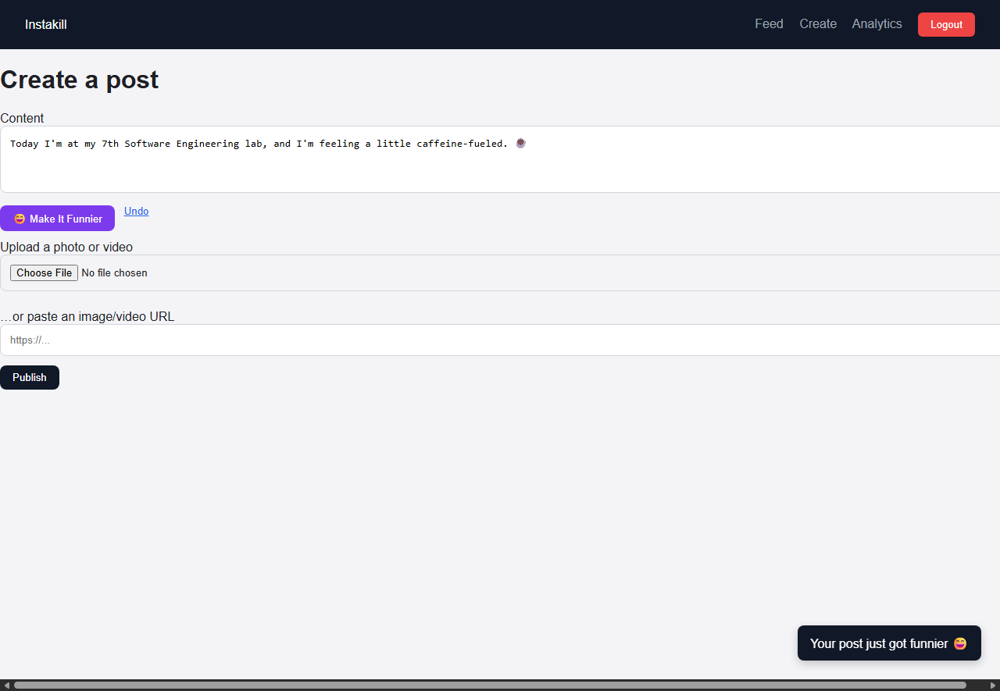
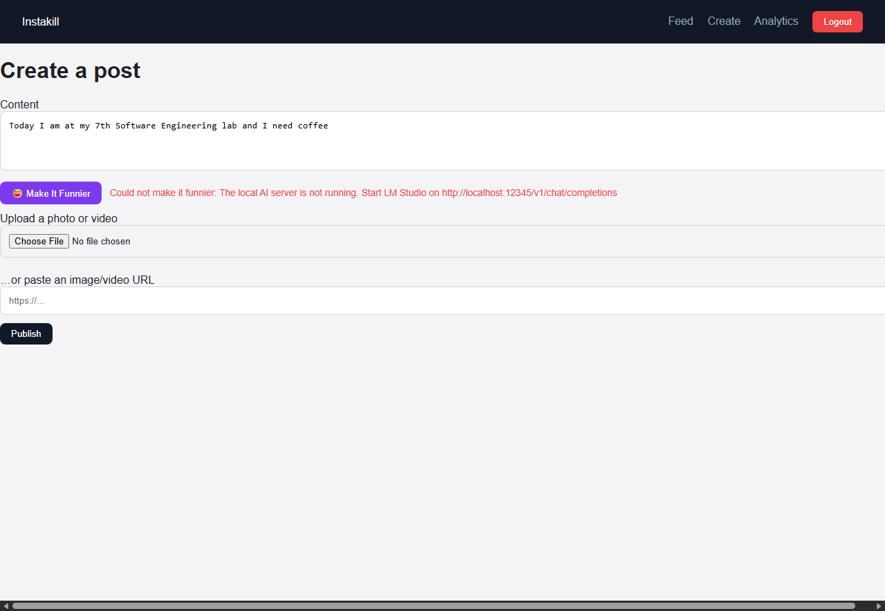

# Lab 7 – „Make My Post Funnier” cu un LLM local

## 1. LM Studio

| Livrabil | Stare |
|---|---|
| LM Studio instalat (0.4.28) | ✅ |
| Model `google/gemma-3-270m` descărcat (`lms get google/gemma-3-270m`) | ✅ |
| Server pornit pe portul **12345** (`lms server start --port 12345`) | ✅ |
| `GET http://localhost:12345/v1/models` | ✅ – [`step5_v1_models.json`](step5_v1_models.json) |
| `POST /v1/chat/completions` (cererea din enunț) | ✅ – [`step6_chat_completion.json`](step6_chat_completion.json) |

## 2. Backend – `POST /api/funnyfy`

```
POST /api/funnyfy        (necesită autentificare)
{ "text": "Today I am at my 7th Software Engineering lab and I need coffee" }

200 OK
{ "text": "Today I'm at my seventh software engineering lab and I need coffee. ☕" }
```

Cod (`backend/src/main/java/com/instakill/funnyfy/`):

- `FunnyfyController` – endpoint-ul; validează textul (nu gol, max. 1000 caractere – aceeași limită ca la postări).
- `FunnyfyService` – construiește conversația pentru model (prompt de sistem + un exemplu + textul utilizatorului) și curăță răspunsul (ghilimele, spații, lungime).
- `LocalLlmClient` – trimite cererea în formatul OpenAI `/v1/chat/completions` (`model`, `messages`, `temperature`, `max_tokens`, `stream: false`) și citește `choices[0].message.content`.
- `LlmException` – tipul erorii și statusul HTTP întors frontend-ului.

**Configurare (URL-ul nu e scris în cod)** – `application.yaml`:

```yaml
instakill:
  llm:
    url: ${LOCAL_LLM_URL:http://localhost:12345/v1/chat/completions}
    model: ${LOCAL_LLM_MODEL:google/gemma-3-270m}
    connect-timeout: 3s
    read-timeout: ${LOCAL_LLM_TIMEOUT:30s}
```

**Tratarea erorilor:**

| Situație | Răspuns |
|---|---|
| LM Studio nu rulează (conexiune refuzată) | `503` + „The local AI server is not running. Start LM Studio on …” (imediat, fără blocare) |
| Modelul nu răspunde în 30 s | `504` |
| LM Studio răspunde cu eroare / răspuns gol sau invalid | `502` |
| Text gol | `422` (validare) |
| Fără login | `401` |

## 3. Frontend – butonul „Make It Funnier”

Pe pagina **Create** (Thymeleaf, `/posts/new`) și în aplicația **Vue**, sub căsuța de text:

1. la click butonul se dezactivează și apare un spinner („Making it funnier…”);
2. textul curent e trimis la `/api/funnyfy`;
3. conținutul căsuței e înlocuit cu varianta amuzantă;
4. la eroare apare un mesaj discret sub buton.

Extra: notificare „Your post just got funnier 😄” și buton **Undo** (revine la textul inițial).

| Înainte | În lucru |
|---|---|
|  |  |
| **După** | **LM Studio oprit** |
|  |  |

## 4. Observații

- **Modelul de 270M e foarte mic.** Cu promptul din enunț, deseori „răspunde” la mesaj („Okay, I understand! Let me know what you need help with.”) în loc să-l rescrie. Am adăugat în conversație un exemplu (few-shot: „I went to the gym today” → „Went to the gym today. The gym won. 🏋️😵”) și o instrucțiune mai strictă; în testele manuale rezultatele au păstrat sensul postării și au devenit mai amuzante. Un model mai mare (de ex. Gemma 3 1B/4B) ar da rezultate mult mai bune – se schimbă doar `LOCAL_LLM_MODEL`.
- Timp de răspuns cu gemma-3-270m: ~0,5–1 s pe laptop.
- Teste automate (fără LM Studio, cu server simulat): `LocalLlmClientTest`, `FunnyfyServiceTest`, `FunnyfyIntegrationTest` – format cerere OpenAI, curățarea răspunsului, erori 502/503/504/422/401 și prezența butonului pe pagină.
