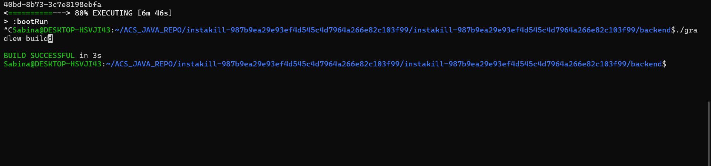
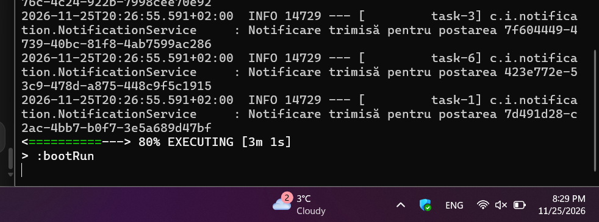
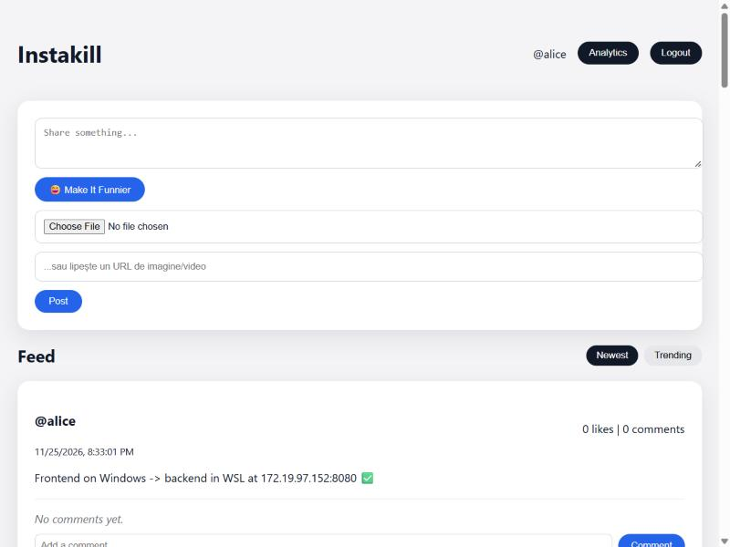

# Lab 8 – Instakill pe Linux (WSL)

Backend-ul rulează în **Ubuntu (WSL)** cu **JDK 21** și **PostgreSQL**, iar frontend-ul Vue rulează pe **Windows** și se conectează la backend-ul din WSL.

## Modificări în proiect

| Fișier | Modificare |
|---|---|
| `backend/build.gradle.kts` | `languageVersion` 23 → **21** (pe Ubuntu, în apt există doar OpenJDK 21) |
| `backend/settings.gradle.kts` | plugin `foojay-resolver-convention` – dacă JDK 21 nu e instalat (ex. pe Windows), Gradle îl descarcă automat |
| `frontend/vite.config.js` | adresa backend-ului se citește din `BACKEND_URL` (implicit `http://localhost:8080`), deci nu mai trebuie editat fișierul când se schimbă IP-ul WSL |
| `scripts/bootstrap-gradle.sh` | marcat executabil în git (`chmod +x`) |

Codul nu folosea funcții din Java 22/23, deci a compilat direct cu Java 21 (bytecode versiunea 65). Toate cele 50 de teste trec.

## Pași

### 1. WSL + Ubuntu (PowerShell ca Administrator)

```powershell
wsl --install            # alege Ubuntu, apoi restart
```

În Ubuntu (după ce creezi utilizatorul și parola):

```bash
sudo apt update && sudo apt upgrade -y
sudo apt install git openjdk-21-jdk unzip -y
git --version
java -version
```

### 2. PostgreSQL

```bash
sudo apt install postgresql postgresql-contrib -y
sudo service postgresql start
sudo service postgresql status
sudo -u postgres psql
```

```sql
CREATE DATABASE instakill;
CREATE USER instakill WITH PASSWORD 'instakill_password';
GRANT ALL PRIVILEGES ON DATABASE instakill TO instakill;
\c instakill
GRANT ALL ON SCHEMA public TO instakill;
ALTER SCHEMA public OWNER TO instakill;
\q
```

```bash
psql -h localhost -U instakill -d instakill     # test login
```

### 3. Clonare și build

```bash
cd ~
git clone https://github.com/sabina200329/ACS_JAVA_REPO.git
ls -al
cd ACS_JAVA_REPO/instakill-*/instakill-*
./scripts/bootstrap-gradle.sh
cd backend
chmod +x gradlew
./gradlew build
ls -l build/libs        # instakill-0.1.0-SNAPSHOT.jar
```

### 4. Pornire backend (cu PostgreSQL din WSL)

```bash
./gradlew bootRun --args='--spring.profiles.active=postgres'
```

Verificare: `curl http://localhost:8080/api/health` (din WSL) sau http://localhost:8080/api/health din browserul de pe Windows.

### 5. Frontend pe Windows, conectat la WSL

```powershell
wsl hostname -I                                  # ex. 172.x.x.x
cd frontend
$env:BACKEND_URL = "http://<IP-WSL>:8080"
npm install
npm run dev
```

Alternativ, IP-ul se pune în `frontend/.env.local` (ignorat de git):

```
BACKEND_URL=http://172.19.97.152:8080
```

La pornire Vite afișează `[vite] backend API -> http://172.19.97.152:8080`. Se deschide http://localhost:5173, login cu `alice` / `password`.

## Mediul folosit

| | |
|---|---|
| Windows 11 Pro + WSL 2 | Ubuntu 26.04.1 LTS |
| Java | OpenJDK 21.0.13 (`apt install openjdk-21-jdk`) |
| Git | 2.53.0 |
| PostgreSQL | 18.6 |
| IP WSL | 172.19.97.152 (`wsl hostname -I`) |

## Dovezi

| Build reușit în Linux (`./gradlew build`) | Backend pornit (`./gradlew bootRun`) |
|---|---|
|  |  |

**Frontend pe Windows (Vite, `localhost:5173`) conectat la backend-ul din WSL** – login cu `alice`, feed-ul vine din PostgreSQL-ul din WSL, iar postarea nouă a fost creată din Windows:



- [`4_health.txt`](4_health.txt) – `GET /api/health` → `{"status":"UP"}` atât direct pe IP-ul WSL, cât și prin proxy-ul Vite.
- [`5_post_in_wsl_postgres.txt`](5_post_in_wsl_postgres.txt) – postarea făcută din frontend-ul de pe Windows, citită cu `psql` din baza `instakill` din WSL.

## Reflecție

Am lucrat aproape tot timpul în terminalul Ubuntu din WSL. Comenzile Linux folosite: `sudo apt update` / `apt upgrade` / `apt install` pentru pachete, `git --version` și `java -version` pentru verificare, `sudo service postgresql start` / `status`, `sudo -u postgres psql` și `psql -h localhost -U instakill -d instakill` pentru baza de date, `cd`, `ls -al`, `chmod +x` pentru navigare și permisiuni, `git clone`, `./scripts/bootstrap-gradle.sh`, `./gradlew build` și `./gradlew bootRun`, iar `hostname -I` pentru IP-ul mașinii Linux.

Prima problemă a fost că aplicația Ubuntu era instalată, dar WSL nu era activat în Windows („virtualization is not enabled”); după `wsl --install` a fost nevoie de un restart. Instalarea părea blocată, dar de fapt se oprise pentru că dădusem click în fereastra PowerShell (modul „Select” pune procesul pe pauză) – s-a rezolvat cu Esc.

Proiectul era configurat pentru Java 23, iar Ubuntu oferă în apt doar OpenJDK 21, așa că am schimbat `languageVersion` la 21; codul nu folosea nimic din Java 22+, deci a compilat direct. Scriptul `bootstrap-gradle.sh` nu avea drept de execuție în git, așa că l-am marcat executabil. Pentru conectarea frontend-ului, adresa backend-ului era scrisă fix în `vite.config.js`; am făcut-o configurabilă prin `BACKEND_URL`, pentru că IP-ul WSL se schimbă la fiecare repornire. În final frontend-ul de pe Windows a comunicat fără probleme cu backend-ul din Linux, iar datele s-au salvat în PostgreSQL-ul din WSL.
